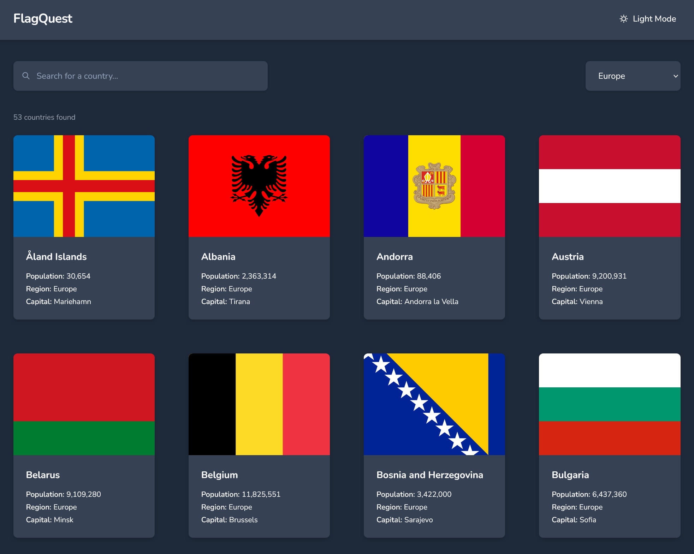
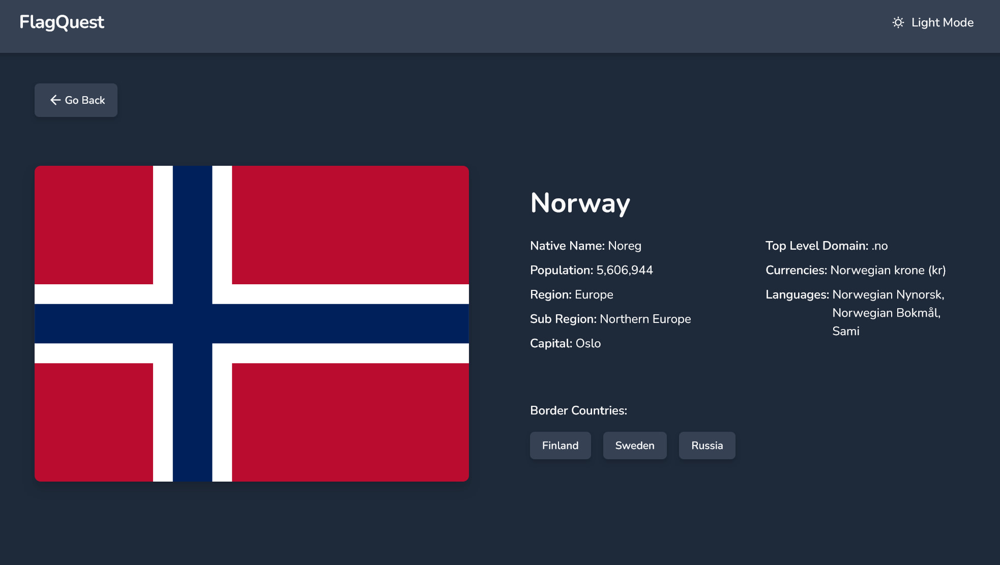

# FlagQuest - REST Countries Explorer

FlagQuest is a responsive country explorer built with React, React Router, and Tailwind CSS. Browse all countries from the [REST Countries API](https://restcountries.com/), search by country name, filter by world region, and view details of the selected country.  

This is a solution to the [REST Countries API with color theme switcher challenge on Frontend Mentor](https://www.frontendmentor.io/challenges/rest-countries-api-with-color-theme-switcher-5cacc469fec04111f7b848ca). Frontend Mentor challenges help you improve your coding skills by building realistic projects. 







## Table of Contents

- [Overview](#overview)
  - [Features](#features)
  - [Links](#links)
  - [Tech Stack](#tech-stack)
  - [Project Structure](#project-structure)
- [Architecture & Key Decisions](#architecture--key-decisions)
  - [Component Design](#component-design)
  - [Utility Functions](#utility-functions)
  - [Theme System](#theme-system)
  - [Accessibility](#accessibility)
- [API reference](#api-reference)
- [Author](#author)


## Overview


### Features

Users may:

- See all countries from the API on the homepage
- Search for a country using an `input` field
- Filter countries by region
- Click on a country to see more detailed information on a separate page
- Click through to the border countries on the detail page
- Toggle the color scheme between light and dark mode

### Links

- [Frontend Mentor solution page](https://your-solution-url.com)
- [live demo site](https://resilient-platypus-dcfded.netlify.app/)


### Tech Stack

| Technology | Purpose |
|---|---|
| React | UI and component architecture |
| React Router | Client-side routing |
| Tailwind CSS | Utility-first styling and dark mode |
| Vite | Build tooling and dev server |
| REST Countries API | Country data source |

### Project Structure

```
src/
├── components/
│   ├── CountryCard.jsx       # Individual country card with flag, metadata, bordering nations
│   ├── SearchControls.jsx    # Search input and region select filtering controls
│   ├── Header.jsx            # App header with theme toggle
│   └── Loader.jsx            # Motion safe spinner for loading states
├── context/
│   ├── CountriesContext.jsx  # Delivers country data across the component tree
│   └── ThemeContext.jsx      # Global dark/light mode state and persistence
├── hooks/
│   ├── useCountries.js       # Fetches and sorts all countries from the API
│   └── useCountryDetail.js   # Fetches a single country by cca3 code
├── pages/
│   ├── CountryDetail.jsx     # Full detail view for a single country
│   ├── Home.jsx              # Homepage with with responsive grid
│   └── NotFound.jsx          # 404 page for unknown routes and invalid codes
└── utils/
    └── formatters.js         # Pure formatting functions to handle API data
```

## Architecture & Key Decisions

### Separation of Data and Theme Concerns

Global state is split across two independent React contexts — `ThemeContext` for light/dark theme modes and `CountriesContext` for the API data. Each context has a specific responsibility.

### One-time fetching to share data across app

Country data is fetched a single time at the app level via `CountriesProvider`, which wraps `BrowserRouter`. Both the `Home` and `CountryDetail` pages consume this data from context instead of fetching independently, eliminating redundant network requests. This also facilitates the resolution of border country names on the detail pages.

### Custom hooks as a data layer

Rather than maintain API call mechanisms within individual page components, I wrote two separate custom hooks to handle the needed fetch logic:

- `useCountries` - handles fetching all countries, sorting, and managing loading and error states.
- `useCountryDetail` - handles fetching a single country by the `cca3` code property from the URL param, and includes cleanup and re-fetching when URL changes

The page components import the hooks, destructure what's needed, and primarily focus on rendering, effectively separating concerns.

Additionally, each hook features a `cancelled` cleanup pattern to prevent potential memory leak issues, such as in a scenario where a user navigates away from the page mid-request:

```js
useEffect(() => {
  let cancelled = false
 
  async function fetchData() {
    const data = await fetch(...)
    if (!cancelled) setState(data)
  }
 
  fetchData()
  return () => { cancelled = true }
}, [])
```

### Component Design

The scope of individual components is limited, generally only extracting when they appear in more than one place or contribute to a cluttered parent file. `Header`, `CountryCard`, and `Loader` were obvious and initial components. `SearchControls` came later after `Home` grew too large and cumbersome. Additionally, I used several internal components with `CountryDetail`, such as `DescListRow` and `BorderCountries`, to make the component more readable and manageable. Since these internal components weren't needed anywhere else in the project, I kept them local.


### Utility Functions

The project implements a number of utility functions to format and/or normalize data received from the API. Additionally, each function takes a defensive approach, assuming there will be gaps in the data (e.g., no capital, no currencies, missing native names, etc.):

```js
export function formatNativeName(nativeName) {
  if (!nativeName) return 'N/A'
  const first = Object.values(nativeName)[0]
  return first?.common || 'N/A'
}
```
`nativeName`, `currencies`, and `languages` are all objects keyed by language or currency codes not known in advance. `Object.values()` extracts the data without needing to know the key, making the formatters resilient to any valid API response shape.

```js
function getBorderName(cca3) {
  const found = countries.find(c => c.cca3 === cca3)
  return found ? found.name.common : cca3
}
```
Effectively generating the border country chip buttons called for another utility function. The API's detail endpoint returns `cca3` codes and resolving those to actual country names would require an additional API call. Instead, the detail page utilizes the utility function to look up the names against already-fetched data, eliminating the need for more network requests.


### Theme System

- Dark/light theme with persistence and OS-preference detection
- Manual light/dark theme toggle
- Smooth color transitions

I utilized [Tailwind's class strategy](https://tailwindcss.com/docs/dark-mode#toggling-dark-mode-manually) along with `localStorage` within `ThemeContext` to manage the user's preferred/selected theme. We first check for a saved preference, then fall back to the OS-level preference:

```js
const [darkMode, setDarkMode] = useState(() => {
  const stored = localStorage.getItem('theme')
  if (stored) return stored === 'dark'
  return window.matchMedia('(prefers-color-scheme: dark)').matches
})
```


### Accessibility

Proper semantic HTML and ARIA attributes are utilized throughout the project. For example, rather than generic `div` elements, the `description list` element is used for displaying country metadata. This is an ideal use case for the `dl` tag and greatly improves the accessibility of the information:

```jsx
<dl>
  <div className="flex gap-1">
    <dt className="font-semibold">Population:</dt>
    <dd>{formatPopulation(population)}</dd>
  </div>
</dl>
```

## API Reference
 
This project uses the [REST Countries API v3.1](https://restcountries.com).
 
| Endpoint | Used for |
|---|---|
| `/v3.1/all?fields=...` | Homepage — all countries, scoped fields |
| `/v3.1/alpha/{cca3}` | Detail page — full data for single country |


## Author

- Website - [Matt Pahuta](https://www.mattpahuta.com)
- Frontend Mentor - [@mattpahuta](https://www.frontendmentor.io/profile/MattPahuta)
- Bluesky - [@mattpahuta](https://bsky.app/profile/mattpahuta.bsky.social)
- LinkedIn - [Matt Pahuta](www.linkedin.com/in/mattpahuta)